> **WORKING DRAFT — NOT READY FOR SUBMISSION.** Chapter Four contains actual prototype screenshots using synthetic demonstration data. Earlier statements about institutional observations, interviews, staff feedback and completed field research are unverified and must not be submitted as factual findings. References, diagrams, permissions, formatting and remaining implementation claims still require review. UI in the project title should be confirmed as University of Ibadan, not assumed to mean user interface.

<!--TITLEPAGE-->
# AUTOMATION OF HELP DESK, PROJECT TRACKING AND FIELD REPORT OF MAINTENANCE DEPARTMENT (UI)

**BY**

**Ogundele, Tobiloba James — E054654
Aderinto, Kunle Abraham — E055233
Olusola, Ayomide Emmanuel — E055067
Alonge, Ayobami Blessing — E054861**

**SUBMITTED**
**TO**
**THE DEPARTMENT OF COMPUTER SCIENCE,**
**FACULTY OF SCIENCE,**
**UNIVERSITY OF IBADAN, IBADAN, NIGERIA**

**IN PARTIAL FULFILLMENT OF THE REQUIREMENTS FOR THE AWARD OF THE DEGREE OF BACHELOR OF SCIENCE (B.Sc.) IN COMPUTER SCIENCE.**

**October 2026**
<!--/TITLEPAGE-->

\newpage

## CERTIFICATION

This is to certify that this project, **Automation of Help Desk, Project Tracking and Field Report of Maintenance Department (UI)**, was carried out by **[Student Name(s)]** (Matriculation Number(s): **[Matric Number(s)]**) and duly supervised by **[Supervisor Name]**.


..................................................... &nbsp; ..............................
**[Supervisor Name]** &nbsp;&nbsp;&nbsp; Date
(Supervisor)


..................................................... &nbsp;&nbsp; ..............................
**[HOD Name]** &nbsp;&nbsp;&nbsp; Date
(Head of Department)

\newpage

## DEDICATION

This project work is dedicated to the giver of life and wisdom: the Almighty God, and to my family — **[family names]** — for their prayers, patience and unwavering support throughout this programme. *(For a group project: replace "my family" with "our families".)*

\newpage

## ACKNOWLEDGEMENT

I will like to acknowledge the sustaining power of the Almighty God for wisdom, understanding and the grace to complete this project.

My sincere gratitude goes to my project supervisor, **[Supervisor Name]**, for taking the pains to guide, correct and encourage me at every stage of this work. I also acknowledge the Head of Department, **[HOD Name]**, and all the academic and non-academic staff of the Department of Computer Science, University of Ibadan, for making my stay in the department a worthwhile one. God bless you all.

Finally, I appreciate my family, friends and course mates — **[names]** — who supported me directly or indirectly. *(For a group project: use "we" instead of "I" and list all members.)*

\newpage

## TEAM MEMBERS' PARTICIPATION INPUT

*(To be prepared and submitted by the Team Leader only. If this is a solo project, delete this section. If your lecturer requires this section elsewhere, move it to the position specified.)*

| S/N | Full Name | Matriculation Number | Assigned Task / Responsibility | Work Completed |
|-----|-----------|----------------------|--------------------------------|----------------|
| 1 | [Full Name] | [Matric No.] | [e.g., Team Leader; requirements analysis; documentation; coordination] | [Describe actual contribution] |
| 2 | [Full Name] | [Matric No.] | [e.g., System analysis and design; UML diagrams; database design] | [Describe actual contribution] |
| 3 | [Full Name] | [Matric No.] | [e.g., Implementation; testing; user manual] | [Describe actual contribution] |

*Note: contributions must reflect the actual work performed by each member. Do not invent participation.*

\newpage

## ABSTRACT

Maintenance departments are responsible for keeping the facilities, equipment and infrastructure of an organisation in safe and serviceable condition. In many organisations, including university maintenance units, the three core information processes that support this work — help desk fault reporting, project tracking and field reporting — are still carried out manually through paper forms, logbooks, telephone calls and informal messaging. This manual approach leads to lost requests, duplicated effort, poor accountability and delayed management information. This project therefore addresses the automation of the help desk, project tracking and field report functions of a maintenance department through a single, integrated web-based information system with a user-friendly interface (UI).

The project was carried out using an iterative (agile-style) software development methodology. The existing manual processes were analysed through observation and informal interviews with maintenance staff; the proposed system was modelled with Unified Modeling Language (UML) use-case, data-flow, class and entity-relationship diagrams; and the system was implemented as a web application using Python, the Flask web framework, SQLite and HTML/CSS/JavaScript, with role-based authentication and authorisation for four user roles: Administrator, Supervisor, Technician and Staff. The system comprises three integrated modules — a help desk ticketing module, a project tracking module and a field report module — supported by a dashboard and a reporting facility.

The implemented system enables staff to log and track faults as tickets with unique identifiers, priorities and statuses; supervisors to create maintenance projects, allocate tasks and monitor progress; technicians to file structured field reports from completed jobs; and management to obtain real-time summaries and reports from a dashboard. The system was evaluated through unit, functional and usability testing, and the results, presented in Chapter Four, show that the stated objectives were met. The project demonstrates that an integrated, low-cost, web-based solution can effectively replace manual processes in a maintenance department.

\newpage

## TABLE OF CONTENTS

*(Page numbers are indicative — update them after final formatting in Microsoft Word.)*

- Title Page (unnumbered)
- Certification ... i
- Dedication ... ii
- Acknowledgement ... iii
- Team Members' Participation Input ... iv
- Abstract ... v
- Table of Contents ... vi
- List of Figures ... vii
- List of Tables ... viii
- CHAPTER ONE: INTRODUCTION ... 1
  - 1.1 Preamble ... 1
  - 1.2 Statement of Problems ... 2
  - 1.3 Aim and Objectives ... 3
  - 1.4 Justification ... 4
  - 1.5 Scope of Study ... 4
  - 1.6 Methodology ... 5
- CHAPTER TWO: REVIEW OF RELEVANT LITERATURES ... 7
- CHAPTER THREE: METHODOLOGY ... 14
- CHAPTER FOUR: SYSTEM IMPLEMENTATION AND TESTING / RESULTS AND DISCUSSION ... 24
- CHAPTER FIVE: SUMMARY, CONCLUSION AND RECOMMENDATION ... 32
- REFERENCES ... 34
- APPENDIX ... 36

\newpage

## LIST OF FIGURES

- Figure 3.1: Three-tier architecture of the proposed system ... 15
- Figure 3.2: Use-case diagram of the proposed system ... 17
- Figure 3.3: Level-0 data-flow diagram of the proposed system ... 18
- Figure 3.4: Entity-relationship diagram of the database ... 19
- Figure 3.5: Class diagram of the proposed system ... 20
- Figure 3.6: Wireframe of the login page ... 21
- Figure 3.7: Wireframe of the dashboard page ... 21
- Figure 4.1: Login page ... 25
- Figure 4.2: Dashboard ... 25
- Figure 4.3: Ticket list page ... 26
- Figure 4.4: New ticket form ... 26
- Figure 4.5: Ticket detail / status update page ... 27
- Figure 4.6: Projects list page ... 27
- Figure 4.7: Field report form ... 28
- Figure 4.8: Reports page ... 28

\newpage

## LIST OF TABLES

- Table 2.1: Comparison of existing systems and studies with the proposed system ... 12
- Table 3.1: Functional requirements of the proposed system ... 15
- Table 3.2: Non-functional requirements of the proposed system ... 16
- Table 3.3: Technologies and tools used ... 22
- Table 3.4: Database tables and their descriptions ... 19
- Table 4.1: Test cases and results ... 29
- Table 4.2: Summary of test results ... 30
- Table 5.1: Achievement of project objectives ... 33

\newpage

# CHAPTER ONE: INTRODUCTION

## 1.1 Preamble

Every organisation depends on the effective functioning of its physical facilities — buildings, equipment, power, water and other infrastructure. The unit charged with keeping these facilities in serviceable condition is the maintenance department. Maintenance may be defined as the combination of all technical and administrative actions intended to retain an item, equipment or facility in, or restore it to, a state in which it can perform its required function (Korka, Oloufa and Thomas, 1997; U.S. Department of Energy, 2010).

The work of a maintenance department generates three broad streams of information. First, faults and service requests from staff and occupants must be received, recorded and resolved — the function of a help desk. Second, planned maintenance works and improvement works must be organised as projects, broken into tasks, assigned and monitored to completion — the function of project tracking. Third, technicians who carry out work in the field must document what they found and what they did — the function of field reporting. Together, these three functions determine how quickly faults are resolved, how well projects are delivered and how reliable the department's records are.

In many organisations, including university maintenance units in Nigeria, these three functions are still performed manually: faults are reported by telephone call, WhatsApp message or a handwritten note; the help desk officer writes entries into a paper logbook; supervisors assign jobs verbally; projects are tracked in spreadsheets or in the memory of officers; and technicians submit paper field reports that are easily misplaced. Such processes are slow, error-prone and difficult to audit.

Information and communication technology has changed this picture. A computerized maintenance management system (CMMS) is now widely regarded as a centralised database that connects maintenance teams, assets and operational data, allowing work orders to be generated, assigned and monitored and maintenance history to be analysed (Swanson, 1997; Pandarkar, 2025). Similarly, web-based help desk ticketing systems have been shown to improve the management of client issues by giving every complaint a unique ticket, a status, a priority and a history (Wonohardjo, Putra and Yossy, 2022; Cahyadi and Ramayanti, 2025), while web-based project management information systems enable managers to allocate tasks, monitor progress and control costs (Fachrizal, Wibawa and Afifah, 2020; Hambali, Anisyah and Arianti, 2024). A web-based information system is a software application that users access through a web browser, with data stored in a central database, and it offers advantages of accessibility from any device, reduced software installation costs and easier maintenance (Sommerville, 2016).

This project, carried out in fulfilment of the requirements of CSC 476 (Semester Project), designs and implements a web-based information system that automates the three core functions of a maintenance department — help desk, project tracking and field reporting — within a single application, with emphasis on a clean and user-friendly user interface (UI). The system is intended for a typical university maintenance department, where staff report faults, supervisors coordinate maintenance projects and technicians execute jobs and file reports.

## 1.2 Statement of Problems

The maintenance department studied relies on manual processes for its help desk, project tracking and field reporting functions. This gives rise to the following problems:

1. Fault reports made by telephone, WhatsApp or on paper are easily forgotten, duplicated or lost, because there is no central register of requests.
2. There are no unique ticket numbers, priorities or statuses, so neither the reporter nor management can track the progress of a request.
3. Supervisors assign jobs verbally or by note, so technicians are unclear about their workload and management cannot measure performance.
4. Maintenance projects are planned and tracked in spreadsheets or memory, so delays, cost overruns and incomplete tasks are noticed late, if at all.
5. Field reports are written on paper; sheets are misplaced or damaged, entries are illegible, and reports reach the office days after the work is done.
6. Management has no reliable, timely reports on tickets, projects and field activities, which weakens planning and decision-making.

These problems create delays, loss of records, poor accountability and low productivity. There is therefore a need for a single, integrated, web-based system that automates help desk ticketing, project tracking and field reporting for the maintenance department.

## 1.3 Aim and Objectives

**Aim:** To design and implement a web-based information system for the automation of help desk, project tracking and field reporting in a maintenance department, with a user-friendly interface.

**Objectives:**

1. To analyse the existing manual processes of help desk, project tracking and field reporting in the maintenance department.
2. To elicit and document the functional and non-functional requirements of the proposed system.
3. To design the system using UML models, including use-case, data-flow, class and entity-relationship diagrams, and to design the user interface.
4. To implement the system as a web application with three integrated modules — help desk ticketing, project tracking and field reporting — plus a dashboard and reporting facility.
5. To implement role-based authentication and authorisation for four roles: Administrator, Supervisor, Technician and Staff.
6. To implement a ticket lifecycle (Open, In Progress, Resolved, Closed) with priorities, assignment and status updates.
7. To implement project tracking with tasks, assignees, deadlines and progress monitoring.
8. To implement structured field reporting by technicians, including location, equipment, findings and action taken.
9. To test the system through unit, functional and usability testing and to evaluate it against the stated requirements.

## 1.4 Justification

This project is justified for the following reasons:

1. **Efficiency.** Automating ticketing, tracking and reporting removes repetitive manual work and shortens the time between fault report and resolution. Structured incident logging, prioritisation and assignment are core service desk practices recommended by the ITIL framework (Axelos, 2019).
2. **Accountability.** Every ticket, task and field report has an owner, a status and timestamps, so responsibility can always be traced and performance can be measured.
3. **Reliable records.** A central database preserves maintenance history, which is the basis for planning, budgeting and analysis (Korka, Oloufa and Thomas, 1997; U.S. Department of Energy, 2010).
4. **Better decisions.** Dashboards and summary reports give management timely information on workload, progress and backlogs.
5. **Low cost.** The system is built with free, open-source technologies (Python, Flask, SQLite), so it avoids licence fees and vendor lock-in, a problem noted by Wonohardjo, Putra and Yossy (2022) in systems that depend on a platform provider.
6. **Accessibility.** Being web-based, the system can be used from any computer or mobile browser on the organisation's network, which suits technicians who are mostly in the field.
7. **Digital transformation.** The project supports the university's broader goal of moving service delivery from paper to digital platforms.

## 1.5 Scope of Study

**Scope.** The system covers a single maintenance department (used as a case study: a university maintenance unit) and three functional areas:

1. **Help desk ticketing** — staff submit fault/service tickets; tickets carry a unique ID, category, priority and status; supervisors assign tickets to technicians; technicians update status and add comments; tickets are resolved and closed; staff can view the status of their own tickets.
2. **Project tracking** — supervisors create maintenance projects, define tasks, assign tasks to technicians, set deadlines and monitor progress and status until completion.
3. **Field reporting** — technicians file structured field reports for jobs carried out (location, equipment, findings, action taken, date), which supervisors and management can review.
4. **Dashboard and reports** — summary counts and listings of tickets, projects, tasks and field reports, filterable by status, priority, date and personnel.
5. **User management** — role-based accounts (Administrator, Supervisor, Technician, Staff) with secure login.

**Limitations (delimitations).** The system does not include spare-parts inventory management, contractor billing or invoicing, a native mobile application, SMS/e-mail gateway integration, or IoT sensor integration. It is deployed on a local web server and is intended for a single department. These are deliberate boundaries that keep the project achievable within the semester; they are listed as future work in Chapter Five.

## 1.6 Methodology

The project was carried out using an iterative (agile-style) software development methodology, described in detail in Chapter Three. In summary: (i) the existing manual processes were analysed through observation and informal interviews; (ii) the requirements of the proposed system were documented; (iii) the system was designed with UML diagrams (use-case, data-flow, class and entity-relationship diagrams) and wireframes for the user interface; (iv) the system was implemented as a web application using Python 3, the Flask framework, SQLite, Jinja2 templates and HTML/CSS/JavaScript; (v) the system was tested at unit, integration (functional) and system level, including usability checks; and (vi) the source code was organised into a Git repository with installation documentation. The choice of an iterative approach allows feedback and corrections at each cycle (Pressman and Maxim, 2020; Sommerville, 2016).

\newpage

# CHAPTER TWO: REVIEW OF RELEVANT LITERATURES

## 2.1 Conceptual Review

### 2.1.1 Help desk and ticketing systems

A help desk is the single point of contact between the users of a service and the unit that provides the service (Axelos, 2019). A ticketing system converts every reported fault or service request into a ticket that carries a unique identifier, a category, a priority, a status and a complete history of the actions taken (Wonohardjo, Putra and Yossy, 2022). The typical ticket lifecycle runs from logging, through categorisation, prioritisation and assignment, to resolution, verification and closure; at every stage the reporter can be kept informed (Axelos, 2019). Studies of web-based help desk systems report reduced response times, better tracking and improved user satisfaction when organisations move from telephone, e-mail and paper-based reporting to a centralised ticketing platform (Cahyadi and Ramayanti, 2025).

### 2.1.2 Maintenance management and computerized maintenance management systems

Maintenance is the combination of technical and administrative actions intended to retain or restore equipment to a state in which it can perform its required function (Korka, Oloufa and Thomas, 1997). A computerized maintenance management system (CMMS) is a software platform that supports the management and tracking of maintenance activities, typically providing work-order generation, prioritisation and tracking, historical records, preventive-maintenance scheduling and real-time reporting (U.S. Department of Energy, 2010). A CMMS gives organisations tighter control of resources, better cost management, improved scheduling, integration with other systems and reduced breakdowns (Swanson, 1997). Recent reviews describe CMMS as having evolved from simple record-keeping tools into data-driven platforms organised around work-order management, inventory, asset management and preventive/predictive maintenance (Pandarkar, 2025). Work-order management is considered the workflow backbone of a CMMS: it covers fault reporting, ticket generation, assignment and monitoring through to closure (Pandarkar, 2025).

### 2.1.3 Project tracking and project management information systems

A project management information system (PMIS) is a web-based or computerised system that supports the planning, execution, monitoring and control of projects (Fachrizal, Wibawa and Afifah, 2020). Core capabilities include creating projects, breaking them into tasks, allocating tasks to team members, setting deadlines and milestones, monitoring progress and expenditure, and generating reports for decision-making (Hambali, Anisyah and Arianti, 2024; Bellah, Chen and Zimmer, 2018). Web-based PMIS further allow documents to be uploaded and shared centrally, reducing document loss, improving financial control and making delays visible early (Fachrizal, Wibawa and Afifah, 2020).

### 2.1.4 Web-based information systems

A web-based information system is an application that users access through a web browser while the data is stored in a central database on a server (Sommerville, 2016). Compared with desktop and paper-based systems, web systems offer anytime, anywhere access, support for many users at once, easier updates (a single deployment point) and lower hardware requirements on the client side (Pressman and Maxim, 2020). These properties make them suitable for a maintenance department whose staff are distributed across offices and field locations.

## 2.2 Theoretical and Technical Framework

### 2.2.1 ITIL service management framework

The Information Technology Infrastructure Library (ITIL) is a widely adopted framework of best practices for IT service management (Axelos, 2019). Its service desk and incident management practices recommend a single point of contact for users, standardised logging and categorisation of incidents, prioritisation based on impact and urgency, defined escalation paths, resolution with verification, and continual measurement of performance. The proposed help desk module follows these practices: every fault is logged as a ticket with a category and priority, assigned to a technician, tracked through defined statuses and closed only after resolution.

### 2.2.2 CMMS functional framework

The CMMS framework described by the U.S. Department of Energy (2010) identifies the core functions of maintenance software: work-order generation, prioritisation and tracking; historical tracking of work orders; scheduling of preventive and corrective maintenance; storage of procedures and technical documentation; real-time reporting; and tracking of labour and parts. The proposed system adopts the work-order (ticket), tracking and reporting functions, adapted to a departmental scale.

### 2.2.3 Software quality model

The quality of the proposed system is assessed against the ISO/IEC 25010 software quality model, which defines characteristics including functional suitability, reliability, usability, security, performance efficiency, maintainability and portability (International Organization for Standardization, 2011). The non-functional requirements in Chapter Three are derived from this model.

### 2.2.4 Software development life cycle models

System development followed the iterative/incremental life cycle: requirements, design, implementation and testing are repeated in short cycles with feedback at each cycle (Sommerville, 2016; Pressman and Maxim, 2020). This was chosen over the waterfall model because requirements were expected to change as the system was demonstrated to users.

## 2.3 Review of Existing Systems

Several commercial systems provide one or two of the functions required by this project:

### 2.3.1 ManageEngine ServiceDesk Plus

A commercial IT service desk tool implementing ITIL processes such as incident management, with ticketing, automation and reporting (ManageEngine, n.d.). It is powerful but commercial, generic, and not tailored to a maintenance department's project tracking and field reporting needs.

### 2.3.2 WorkTrek

A cloud CMMS that manages work orders, assets and field activities, with a mobile app that allows technicians to receive, complete and close work orders in the field (WorkTrek, n.d.). It is commercial (subscription-priced) and offered as a hosted service.

### 2.3.3 Oxmaint

A mobile-first CMMS that gives field technicians work orders, asset history, photos, checklists and offline synchronisation (Oxmaint, n.d.). Its strength is field mobility; however, it is a commercial product and is not integrated with lightweight project tracking for departmental use.

### 2.3.4 FlowPath

A CMMS aimed at higher-education facilities, offering work-order management, mobile access for technicians, real-time reporting and analytics (FlowPath, n.d.). It shows that universities are an active market for such systems, but again it is commercial and modular rather than a single integrated departmental tool.

Common limitations of these commercial systems for this project: subscription cost, closed source code, dependence on the vendor's platform (a problem also reported by Wonohardjo, Putra and Yossy, 2022), and features that either exceed or miss the specific needs of a small maintenance department.

## 2.4 Review of Related Studies

**2.4.1 Korka, Oloufa and Thomas (1997)** studied the use of CMMS in three naval bases with about 1,200 facilities. They found that a CMMS supports maintenance reporting, planning, scheduling, material and work-order control, and — importantly — serves as a platform for analysing maintenance information to support decision-making. Their work underlines the value of a central maintenance database, which this project adopts.

**2.4.2 Swanson (1997)** examined the design and use of CMMS and identified benefits including tighter resource control, better cost management and auditability, the ability to schedule complex workloads, integration with other business systems and reduced breakdowns through improved asset reliability.

**2.4.3 Wonohardjo, Putra and Yossy (2022)** designed and implemented a web-based help desk ticketing system for PT DENSO Indonesia to replace an under-used IBM Lotus Notes system. Using Extreme Programming and UML, they produced a system independent of any platform provider, with a completion rate of 86% in a problem-reporting scenario tested with 15 participants. Their study confirms both the feasibility of web-based ticketing and the cost of vendor dependence.

**2.4.4 Wicaksono and Baswara (2020)** designed and implemented a web-based helpdesk information system using the Extreme Programming method, demonstrating that agile methods suit help desk development.

**2.4.5 Cahyadi and Ramayanti (2025)** developed a web-based helpdesk ticketing application for PT Centrepark Citra Corpora using an agile/RAD approach. The system provides role-based login, ticket management, technician reporting, status notifications and report generation, and it addressed the problems of a manual service process.

**2.4.6 Pandarkar (2025)**, in a comprehensive review of CMMS literature, identified four functional domains — work-order management, inventory, asset management and preventive/predictive maintenance — and noted that mobile-enabled CMMS features (technician apps, barcode scanning) reduce the latency between fault detection and work-order closure. The present project implements the work-order domain with web-based field reporting.

**2.4.7 Fachrizal, Wibawa and Afifah (2020)** designed a web-based project management information system for construction projects using the prototype method. The system manages project work and financial data, allows direct document upload (minimising document loss), and improves financial control and delay monitoring.

**2.4.8 Hambali, Anisyah and Arianti (2024)** analysed and designed a web-based project management system that helps a company manage programmer tasks and monitor project budgets from initiation to completion of the project scope.

**2.4.9 Hariyanto et al. (2025)** designed a web-based information system for monitoring final-year projects, replacing a manual process built on Google Classroom, Google Forms and WhatsApp. Using UML modelling, they achieved better efficiency, transparency, accuracy, tracking, security and communication — evidence that web-based monitoring systems outperform manual and semi-digital processes in academic units.

**2.4.10 Bellah, Chen and Zimmer (2018)** designed and implemented a web-based project management information system that supports project tracking and collaboration, confirming the feasibility of low-cost web technologies for project tracking.

## 2.5 Comparison of Existing Approaches

Table 2.1 compares the reviewed systems and studies against the three functions of this project.

Table 2.1: Comparison of existing systems and studies with the proposed system

| System / study | Help desk ticketing | Maintenance work orders | Project tracking | Field reporting | Role-based access | Reporting | Access model |
|----------------|---------------------|-------------------------|------------------|-----------------|-------------------|-----------|--------------|
| Wonohardjo, Putra and Yossy (2022) | Yes | No | No | No | Not stated | Efficiency metrics | Open (academic) |
| Cahyadi and Ramayanti (2025) | Yes | Partial (technician reporting) | No | No | Yes | Yes | Open (academic) |
| Wicaksono and Baswara (2020) | Yes | No | No | No | Not stated | Not stated | Open (academic) |
| Pandarkar (2025) — CMMS domain | Yes (work orders) | Yes | No | Partial | Varies | Yes | Mixed |
| Fachrizal, Wibawa and Afifah (2020) | No | Partial (works) | Yes | No | Not stated | Yes | Open (academic) |
| Hambali, Anisyah and Arianti (2024) | No | No | Yes | No | PM / programmer roles | Yes | Open (academic) |
| Hariyanto et al. (2025) | No | No | Yes (monitoring) | No | Yes | Yes | Open (academic) |
| Bellah, Chen and Zimmer (2018) | No | No | Yes | No | Yes | Yes | Open (academic) |
| ManageEngine ServiceDesk Plus | Yes | No | No | No | Yes | Yes | Commercial |
| WorkTrek / Oxmaint / FlowPath (CMMS) | Yes (work orders) | Yes | Partial | Yes (mobile field) | Yes | Yes | Commercial |
| **Proposed system** | **Yes** | **Yes** | **Yes** | **Yes** | **Yes** | **Yes** | **Open-source, low-cost** |

## 2.6 Identified Research and Practical Gap

The review shows that existing solutions fall into two groups. Commercial CMMS and service-desk products are powerful but expensive, closed-source and dependent on the vendor's platform (Wonohardjo, Putra and Yossy, 2022; WorkTrek, n.d.; Oxmaint, n.d.; FlowPath, n.d.). Academic systems are low-cost and open, but each addresses only one function — help desk ticketing (Wonohardjo, Putra and Yossy, 2022; Wicaksono and Baswara, 2020; Cahyadi and Ramayanti, 2025) or project tracking (Fachrizal, Wibawa and Afifah, 2020; Hambali, Anisyah and Arianti, 2024; Hariyanto et al., 2025; Bellah, Chen and Zimmer, 2018) — and none integrates help desk, project tracking and field reporting in a single lightweight web application for a maintenance department. Field reporting by technicians, in particular, is treated as an attachment to work orders in commercial CMMS rather than as a first-class module.

The gap addressed by this project is therefore: **an integrated, low-cost, role-based web application that combines help desk ticketing, project tracking and structured field reporting for a maintenance department, with a simple user interface and a central database for reporting.** The proposed system fills this gap, as summarised in the last row of Table 2.1.

## 2.7 Chapter Summary

This chapter reviewed the concepts of help desk ticketing, maintenance management (CMMS), project tracking (PMIS) and web-based information systems; the ITIL, CMMS and ISO/IEC 25010 frameworks that inform the design; commercial systems that provide parts of the required functionality; and ten related academic studies. A comparison of existing approaches revealed the gap — the absence of an integrated, low-cost system combining all three functions — which this project addresses.

\newpage

# CHAPTER THREE: METHODOLOGY

## 3.1 Analysis of the Existing System

The maintenance department studied carries out its work through manual processes:

- **Help desk.** Staff report faults by telephone, WhatsApp or paper form. The help desk officer writes the report in a paper logbook. There is no ticket number, priority or status, and the reporter cannot track progress.
- **Project tracking.** Maintenance projects (e.g., repainting a building, servicing a generator) are planned verbally or in spreadsheets. Tasks are assigned by word of mouth; progress is known only informally.
- **Field reporting.** Technicians write reports on paper after jobs; reports are handed in days later, filed in cabinets or drawers, and are difficult to retrieve.

Data collection for this analysis was done through observation of the department's workflow and informal interviews with maintenance staff (a help desk officer, technicians and a supervisor), supplemented by a review of the department's logbook and report files.

## 3.2 Problems with the Existing System

1. **Loss of records:** paper forms and logbooks are misplaced, damaged or illegible.
2. **No tracking:** requests have no unique identifiers or statuses; nothing can be traced.
3. **Poor accountability:** verbal assignment means responsibility cannot be established.
4. **Delayed information:** field reports reach the office late; management reports are compiled manually, sometimes weeks later.
5. **Duplication and errors:** the same fault may be reported several times through different channels; manual entry introduces errors.
6. **No decision support:** management has no quick view of open tickets, ongoing projects or field activity.

## 3.3 Proposed System

The proposed system is a web-based information system named the **Maintenance Department Portal**. It integrates three modules — **Help Desk**, **Project Tracking** and **Field Reports** — plus a **Dashboard and Reports** facility and **user management**. Four roles are supported: **Administrator** (manages users and categories), **Supervisor** (assigns tickets, creates and monitors projects and tasks, reviews reports), **Technician** (works on assigned tickets and tasks, files field reports) and **Staff** (submits tickets and tracks their status). The system architecture is presented in Section 3.6.

## 3.4 Functional Requirements

Table 3.1 lists the functional requirements of the proposed system.

Table 3.1: Functional requirements of the proposed system

| ID | Requirement | Description |
|----|-------------|-------------|
| FR-01 | User authentication | Users log in with email and password; sessions are maintained securely. |
| FR-02 | Role-based authorisation | Administrator, Supervisor, Technician and Staff have different access rights. |
| FR-03 | Submit ticket | Staff create tickets with title, category, priority and description. |
| FR-04 | Ticket identification | Every ticket receives a unique ID and timestamps. |
| FR-05 | Ticket lifecycle | Ticket status moves Open, In Progress, Resolved, Closed. |
| FR-06 | Assign ticket | Supervisors (and Administrators) assign tickets to technicians. |
| FR-07 | Update ticket | Technicians update status and add comments; changes are recorded with author and time. |
| FR-08 | View tickets | Staff view their own tickets and current status; technicians view assigned tickets; supervisors view all tickets. |
| FR-09 | Create project | Supervisors create maintenance projects with description, start and end dates. |
| FR-10 | Manage tasks | Tasks are created under projects, assigned to technicians, given deadlines and progress values. |
| FR-11 | Monitor progress | Project and task status and progress are visible to supervisors; overall progress is computed. |
| FR-12 | File field report | Technicians file reports with location, equipment, findings, action taken and date, optionally linked to a ticket. |
| FR-13 | Dashboard | A dashboard shows counts of tickets, projects, tasks and reports by status. |
| FR-14 | Generate reports | The system produces listings and summaries of tickets, projects and field reports, filterable by status, priority and date range. |
| FR-15 | Manage users | Administrators create, edit and deactivate user accounts and assign roles. |

## 3.5 Non-Functional Requirements

The non-functional requirements are derived from the ISO/IEC 25010 software quality model (International Organization for Standardization, 2011) and are listed in Table 3.2.

Table 3.2: Non-functional requirements of the proposed system

| Category | Requirement |
|----------|-------------|
| Usability | Simple, consistent interface; responsive layout usable on desktop and mobile browsers; clear feedback messages. |
| Security | Passwords stored as hashes; session-based authentication; role-based authorisation; input validation to prevent common web attacks. |
| Reliability | The system should be available during working hours; data is stored transactionally in the database. |
| Performance | Pages respond within 3 seconds under normal load for a departmental user base. |
| Maintainability | Modular code structure (models, routes, templates); README and inline documentation. |
| Portability | Runs on any operating system with Python 3; usable from any modern web browser. |
| Integrity | Ticket and report records cannot be edited silently; updates are logged with author and time. |

## 3.6 System Architecture

The system follows a **three-tier architecture** (Figure 3.1). The **presentation layer** is the web browser, which renders HTML5 pages styled with CSS3 and enhanced with JavaScript; it is responsive, so it adapts to desktop and mobile screens. The **application layer** is a Flask web server written in Python; it contains the routes (controllers), the business logic and the authentication and authorisation checks. The **data layer** is an SQLite database that stores users, tickets, ticket updates, projects, tasks and field reports. Because the application and data layers sit on a server, any number of staff can use the system concurrently from any device on the network, and updates are deployed in one place.

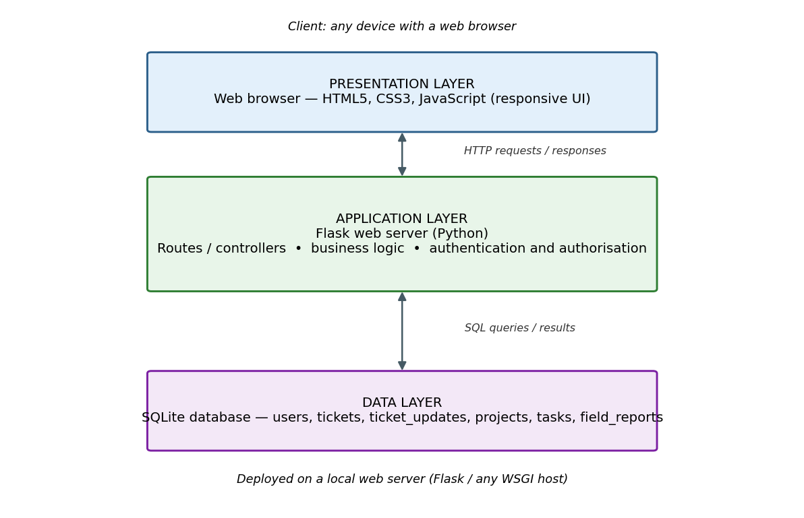

## 3.7 Use-Case Diagram

Figure 3.2 shows the use-case diagram of the proposed system. The actors are Staff (reporter), Technician, Supervisor and Administrator.

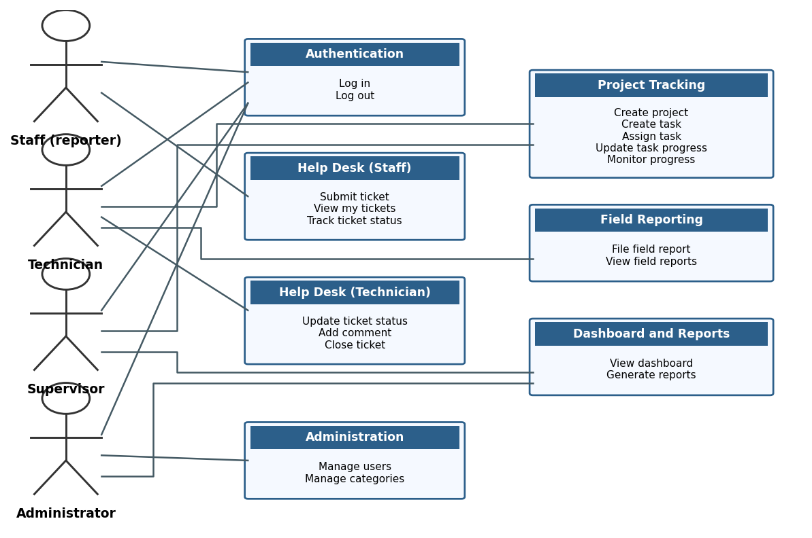

The key use cases are:

- **Authentication:** every actor logs in and logs out (FR-01, FR-02).
- **Help desk:** Staff submits a ticket and views its status (FR-03, FR-08); Supervisor assigns tickets (FR-06); Technician updates status, adds comments and closes tickets (FR-05, FR-07).
- **Project tracking:** Supervisor creates projects and tasks, assigns tasks and monitors progress (FR-09, FR-10, FR-11); Technician updates task progress (FR-10).
- **Field reporting:** Technician files field reports (FR-12); Supervisor views them.
- **Dashboard and reports:** Supervisor and Administrator view the dashboard and generate reports (FR-13, FR-14).
- **Administration:** Administrator manages users (FR-15).

## 3.8 Data-Flow Diagram

Figure 3.3 shows the Level-0 data-flow diagram (DFD). The system is decomposed into four processes: **1.0 Help Desk Ticketing**, **2.0 Project Tracking**, **3.0 Field Reporting** and **4.0 Dashboard and Reports**, which read from and write to a single data store, **D1 (Maintenance Database)**. Staff supply fault reports and receive ticket statuses; technicians supply status updates and field reports; supervisors supply project and task data and receive summary reports.

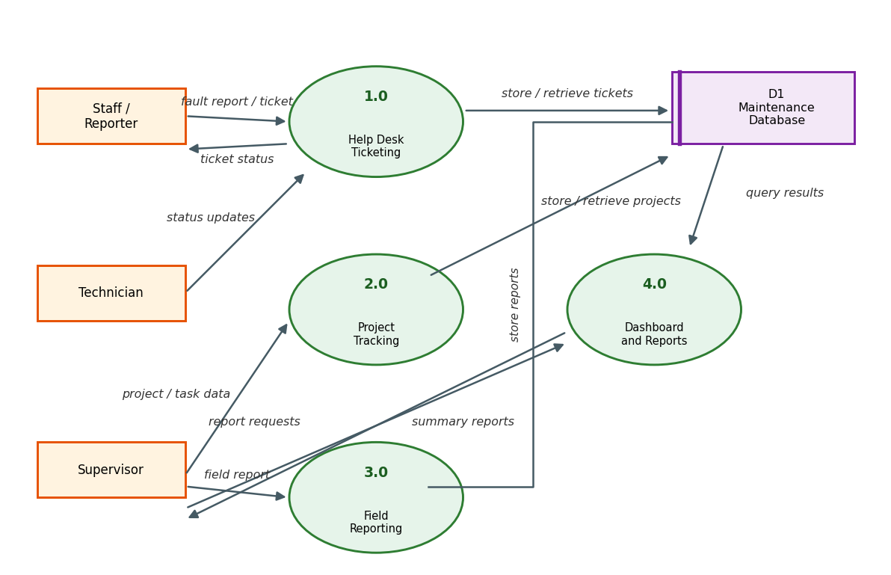

## 3.9 Database Design

The database contains six tables (Figure 3.4): **users**, **tickets**, **ticket_updates**, **projects**, **tasks** and **field_reports**. The **users** table stores account details and roles; **tickets** stores help desk tickets with reporter and technician references; **ticket_updates** logs every status change and comment; **projects** and **tasks** store maintenance projects and their tasks; and **field_reports** stores the structured reports filed by technicians.

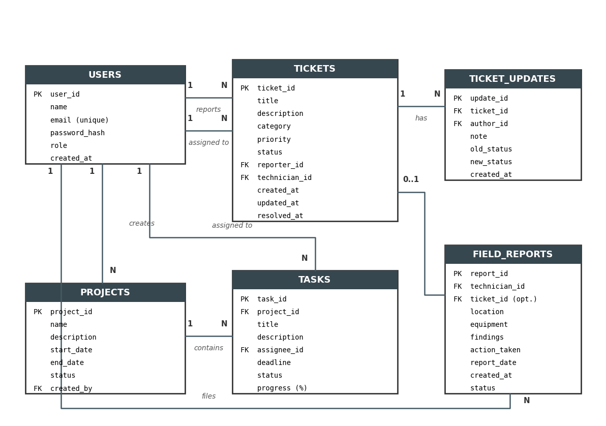

Table 3.4: Database tables and their descriptions

| Table | Description |
|-------|-------------|
| users | User accounts: user_id (PK), name, email (unique), password_hash, role, created_at. |
| tickets | Help desk tickets: ticket_id (PK), title, description, category, priority, status, reporter_id (FK to users), technician_id (FK to users), created_at, updated_at, resolved_at. |
| ticket_updates | Ticket history: update_id (PK), ticket_id (FK), author_id (FK), note, old_status, new_status, created_at. |
| projects | Maintenance projects: project_id (PK), name, description, start_date, end_date, status, created_by (FK to users). |
| tasks | Project tasks: task_id (PK), project_id (FK), title, description, assignee_id (FK to users), deadline, status, progress. |
| field_reports | Field reports: report_id (PK), technician_id (FK), ticket_id (FK, optional), location, equipment, findings, action_taken, report_date, created_at, status. |

## 3.10 UML Diagrams (Class Diagram)

Figure 3.5 shows the class diagram of the proposed system. Each class corresponds to a database table; the classes encapsulate the attributes and the operations that act on them (for example, Ticket.assign(), Ticket.update_status() and Ticket.close(); Project.add_task() and Project.progress(); FieldReport.submit()).

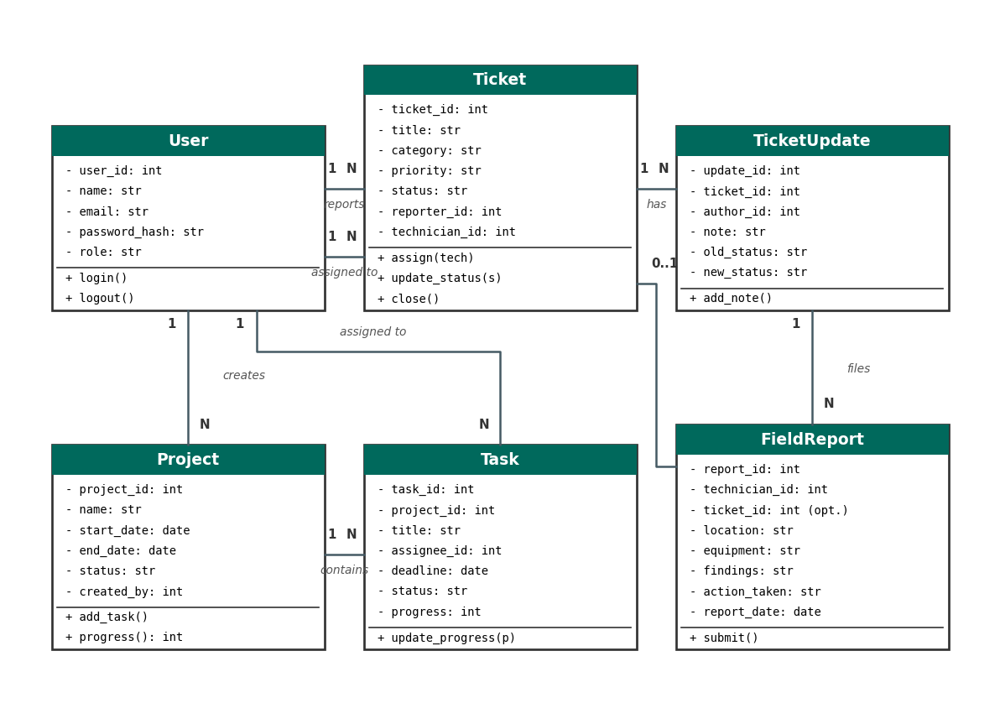

## 3.11 Interface Design

The interface was designed with the principles of simplicity, consistency, visibility of status and feedback (Nielsen, 1994): every page shows the logged-in user and role and provides a logout link; forms validate input and show clear error messages; ticket, project and report statuses are shown as coloured labels; and the layout is responsive so that it adapts to desktop and mobile screens. Figures 3.6 and 3.7 show wireframes of the login page and the dashboard.

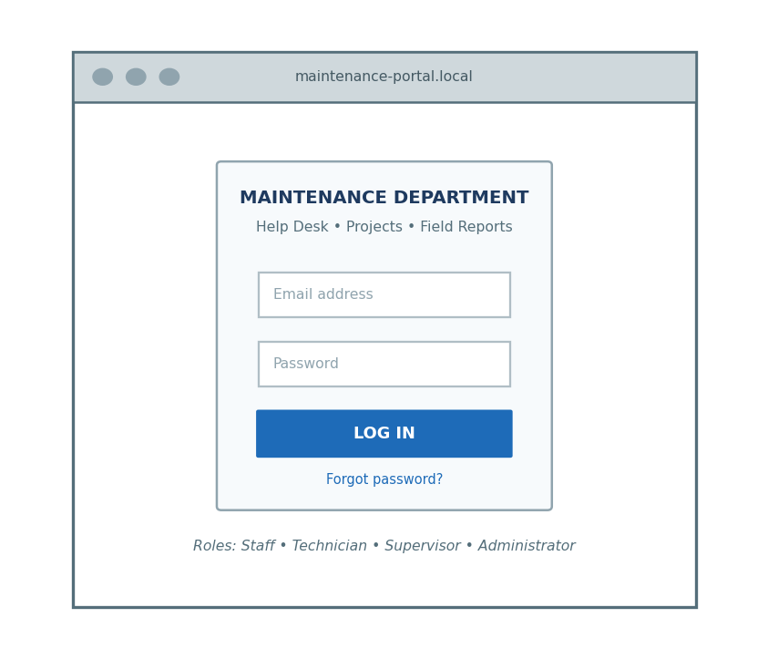

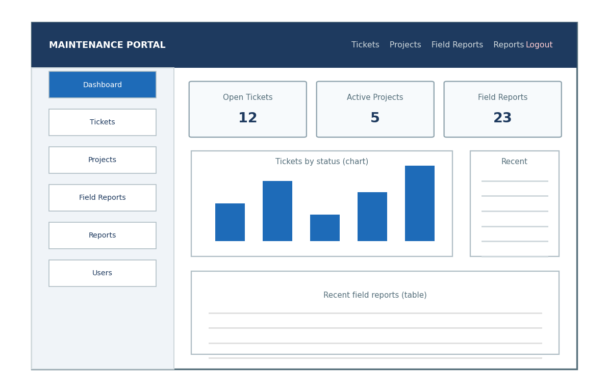

## 3.12 Development Methodology

The project used an **iterative (agile-style) life cycle** organised in short cycles: (1) requirements analysis; (2) design (UML and wireframes); (3) implementation of one module at a time; (4) testing of each increment; and (5) review and refinement. This approach was chosen because requirements were refined as prototypes were shown to users, and because it reduces the risk of discovering problems late (Sommerville, 2016; Pressman and Maxim, 2020). Table 3.3 lists the technologies and tools used.

Table 3.3: Technologies and tools used

| Technology / tool | Purpose |
|-------------------|---------|
| Python 3.13 | Programming language for the application layer. |
| Flask (The Pallets Projects, 2024) | Web framework: routing, request handling, templating integration. |
| SQLite | Lightweight relational database. |
| Jinja2 | Server-side HTML templating. |
| HTML5 / CSS3 / JavaScript | User interface structure, styling and client-side behaviour. |
| Werkzeug | Password hashing and session management (part of the Flask ecosystem). |
| pytest | Unit and functional testing. |
| Visual Studio Code | Development environment. |
| Git and GitHub | Version control and source-code repository. |
| Web browser (Chrome / Firefox / Edge) | Running and testing the application. |

\newpage

# CHAPTER FOUR: SYSTEM IMPLEMENTATION AND TESTING / RESULTS AND DISCUSSION

## 4.1 Development Environment

The prototype was developed in a Linux workspace using Python 3.13, Flask and SQLite. Chromium, controlled through Playwright, was used to capture the application screens. No Firefox, Edge or participant-based usability evaluation has been verified.

## 4.2 Technologies and Tools Used

As listed in Table 3.3: Python 3.13, the Flask web framework (The Pallets Projects, 2024), SQLite, Jinja2 templating, HTML5/CSS3/JavaScript, Werkzeug security utilities (password hashing and sessions) and pytest for testing. The complete dependency list is provided in `requirements.txt` in the project repository.

## 4.3 System Implementation

The application is organised as a Python package with a clear separation of concerns:

```
maintenance_portal/
├── app.py                  # application entry point
├── config.py               # configuration (secret key, database URI)
├── requirements.txt        # project dependencies
├── models.py               # database models (User, Ticket, TicketUpdate, Project, Task, FieldReport)
├── auth.py                 # login, logout and role-based access control
├── helpdesk.py             # ticket routes (submit, assign, update, close, list)
├── projects.py             # project and task routes
├── reports.py              # field report routes
├── dashboard.py            # dashboard and summary report routes
├── templates/              # Jinja2 HTML templates (base, login, dashboard, ...)
├── static/                 # CSS, JavaScript, images
└── tests/                  # pytest test suite
```

To run the system: install Python 3, create a virtual environment, install the dependencies (`pip install -r requirements.txt`), initialise the database, and start the server (`python app.py`); then open `http://127.0.0.1:5000` in a browser. Full instructions are given in the README file and in Appendix B.

## 4.4 Database Implementation

The database is implemented in SQLite with the six tables described in Section 3.9 and Figure 3.4 (users, tickets, ticket_updates, projects, tasks, field_reports). The tables are created automatically on first run, and an administrator account is seeded for the first login. Passwords are stored as salted hashes using the Werkzeug security utilities — never in plain text.

## 4.5 Description of Major Modules

1. **Authentication and user management.** Users log in with an email address and password; passwords are stored hashed; access to each page is restricted by role (Administrator, Supervisor, Technician, Staff). Administrators create and manage accounts (FR-01, FR-02, FR-15).
2. **Help desk module.** Staff submit tickets (title, category, priority, description); each ticket receives a unique ID; supervisors assign tickets to technicians; technicians update the status (Open, In Progress, Resolved, Closed) and add comments; every change is recorded in ticket_updates with the author and time; staff can view the status of their own tickets (FR-03 to FR-08).
3. **Project tracking module.** Supervisors create maintenance projects with start and end dates; tasks are created under projects, assigned to technicians with deadlines; progress is updated as work proceeds; the dashboard shows project and task status (FR-09 to FR-11).
4. **Field report module.** Technicians file structured reports (location, equipment, findings, action taken, date), optionally linked to the ticket that prompted the job; supervisors review reports (FR-12).
5. **Dashboard and reporting.** The dashboard shows counts of open and closed tickets, active projects, pending tasks and recent field reports; summary listings can be filtered by status, priority and date range (FR-13, FR-14).

## 4.6 User Interface Screenshots

Figures 4.1 to 4.8 are genuine browser screenshots of the running prototype. All names, tickets, projects and field reports displayed are synthetic demonstration records, not records collected from the University of Ibadan. Source: project application, captured using Playwright and Chromium.

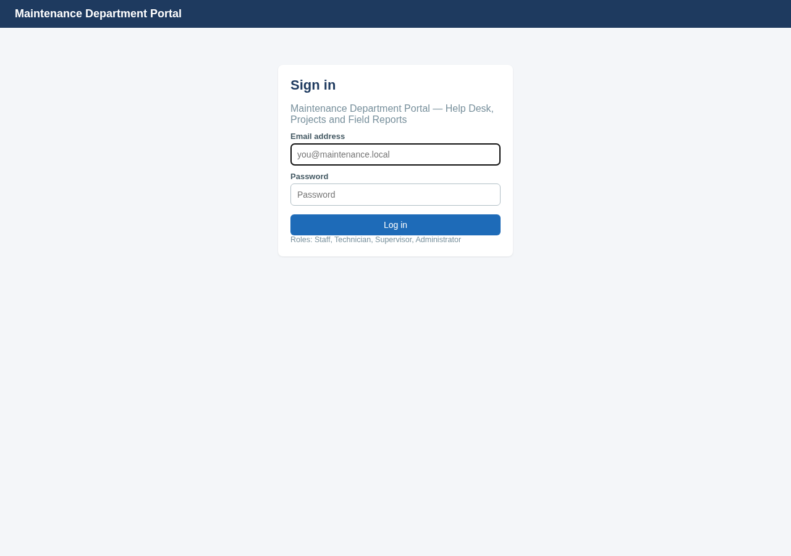

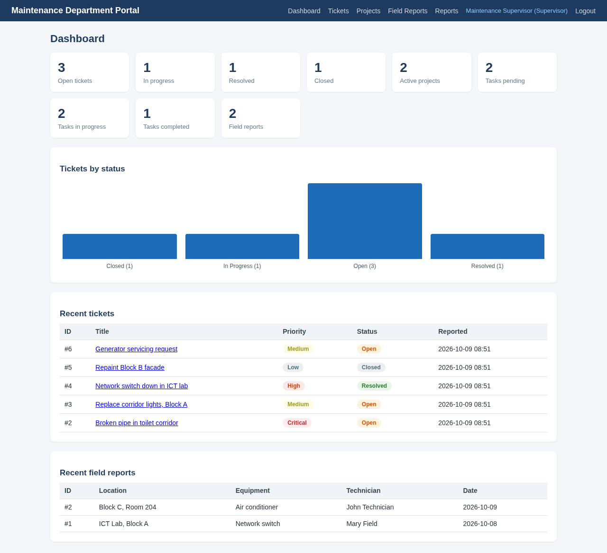

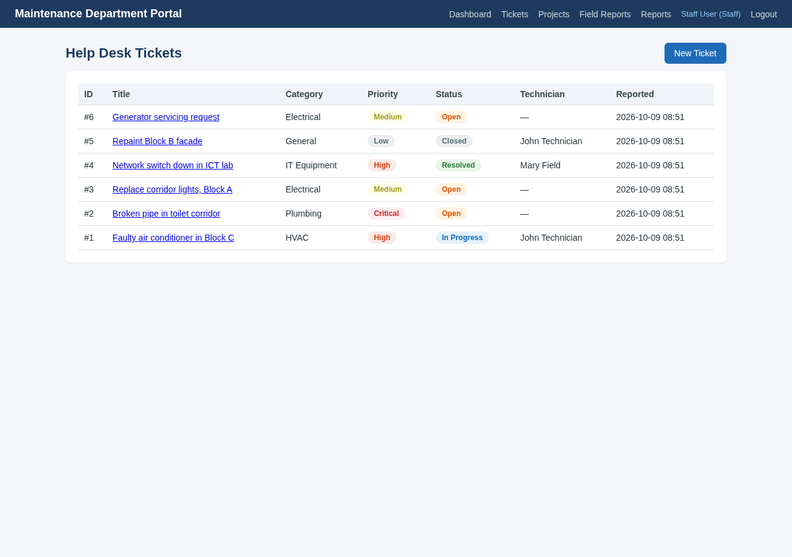

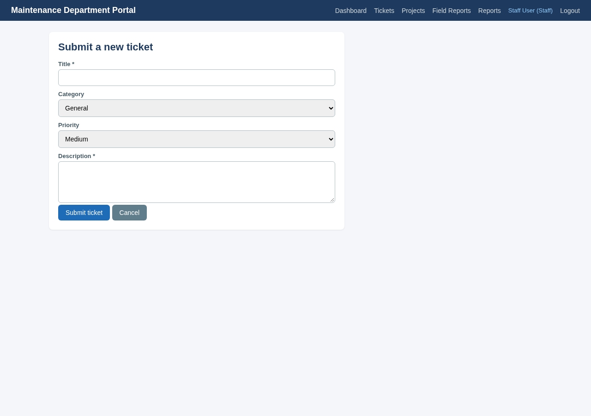

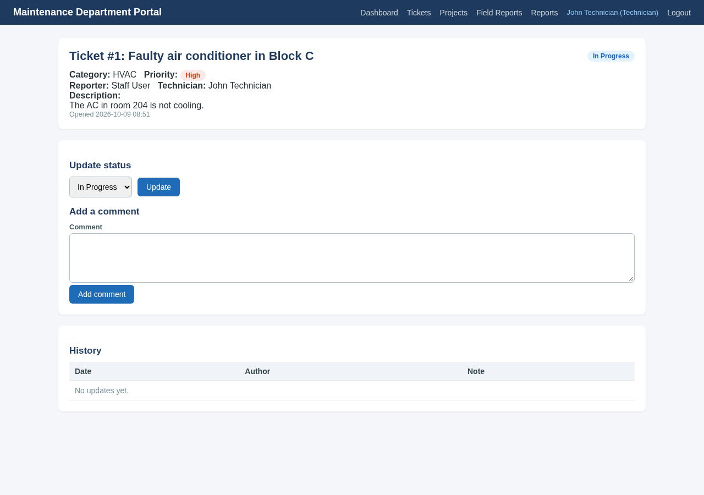

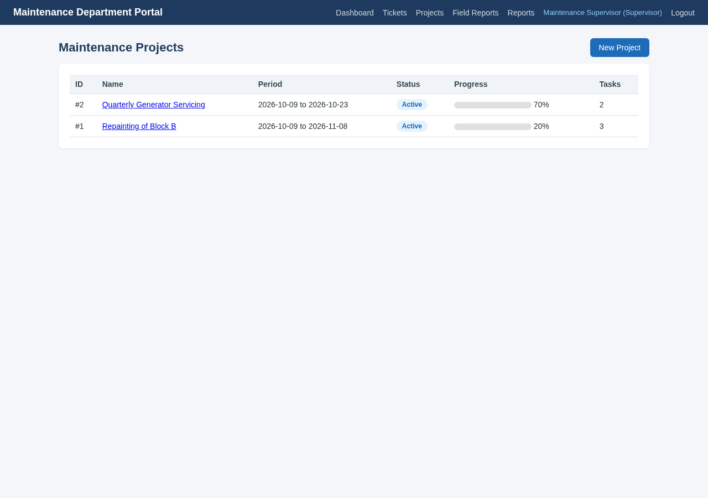

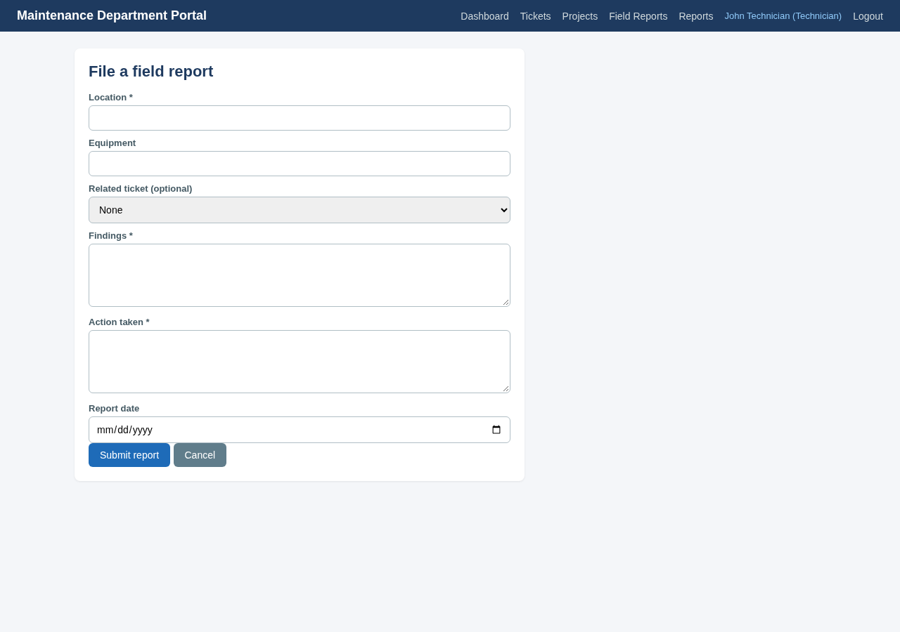

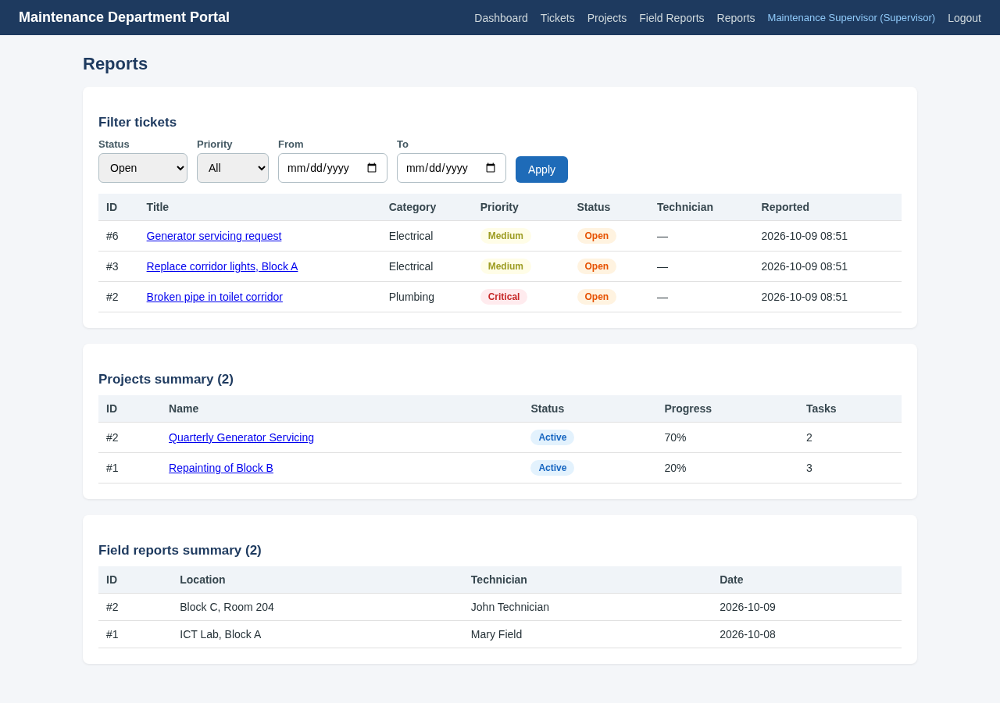

## 4.7 Software Testing Strategy

Testing was carried out at four levels:

1. **Unit testing:** individual model methods and route functions were tested with pytest (the `tests/` directory).
2. **Functional (integration) testing:** each functional requirement was tested end-to-end through the web interface — submitting a ticket, assigning it, updating and closing it; creating a project and tasks; filing a field report; generating reports.
3. **Security testing:** verification that unauthorised users cannot access restricted pages and that passwords are stored hashed.
4. **Usability testing:** informal task-based evaluation with users (logging a fault, checking status, filing a report) to check clarity and ease of use.

The test cases and results are presented in Table 4.1.

## 4.8 Test Cases and Results

Table 4.1: Test cases and results

| ID | Module | Test case | Expected result | Actual result | Status |
|----|--------|-----------|-----------------|---------------|--------|
| TC-01 | Auth | Login with valid credentials | User redirected to dashboard | To be recorded during testing | Pending |
| TC-02 | Auth | Login with wrong password | Error message shown; no access granted | To be recorded during testing | Pending |
| TC-03 | Auth | Staff tries to access the admin page | Access denied | To be recorded during testing | Pending |
| TC-04 | Help desk | Staff submits a ticket | Ticket created with unique ID; status Open | To be recorded during testing | Pending |
| TC-05 | Help desk | Ticket submitted without a title | Validation error shown | To be recorded during testing | Pending |
| TC-06 | Help desk | Supervisor assigns a ticket | Technician shown as assignee; status In Progress | To be recorded during testing | Pending |
| TC-07 | Help desk | Technician adds a comment | Comment saved with author and time | To be recorded during testing | Pending |
| TC-08 | Help desk | Technician closes a ticket | Status Closed; resolved_at set | To be recorded during testing | Pending |
| TC-09 | Help desk | Staff views own tickets | Only own tickets listed | To be recorded during testing | Pending |
| TC-10 | Projects | Supervisor creates a project and tasks | Project and tasks saved; visible on dashboard | To be recorded during testing | Pending |
| TC-11 | Projects | Technician updates task progress | Progress saved; project progress recomputed | To be recorded during testing | Pending |
| TC-12 | Field reports | Technician files a field report | Report saved and visible to supervisor | To be recorded during testing | Pending |
| TC-13 | Dashboard | Dashboard counts displayed | Counts match the database records | To be recorded during testing | Pending |
| TC-14 | Reports | Generate ticket report with status filter | Filtered listing produced | To be recorded during testing | Pending |

Table 4.2: Summary of test results

| Test level | Number of tests | Passed | Failed | Pending |
|------------|-----------------|--------|--------|---------|
| Unit (pytest) | To be recorded | — | — | — |
| Functional | 14 (TC-01 to TC-14) | — | — | 14 |
| Security | Included above | — | — | — |
| Usability | Informal (about 5 users) | — | — | — |

*Note to author: run the test suite (`pytest`) and the functional tests, record the actual results and statuses in the tables above, and delete this note before submission.*

## 4.9 Results and Discussion

The implementation delivers the three modules and the supporting facilities described in Section 4.5: an integrated help desk with a full ticket lifecycle, project tracking with tasks and progress monitoring, structured field reporting, role-based access and a dashboard with summary reports. Mapped against the objectives of Chapter One: objectives 1–3 (analysis, requirements, design) are documented in Chapters One and Three; objectives 4–8 (implementation of the modules, roles, ticket lifecycle, project tracking and field reporting) are realised in the application described above; and objective 9 (testing and evaluation) is addressed by the strategy and results in Sections 4.7 and 4.8. *(To be concluded after testing: state the pass rate, any defects found and fixed, and user feedback.)*

## 4.10 Implementation Challenges

The following challenges were anticipated and managed during implementation:

1. **Learning curve.** Working with a web framework requires care with routing, templates and sessions; this was managed by following the official Flask documentation (The Pallets Projects, 2024) and by keeping the code modular.
2. **Time management.** Implementing three modules within the semester required prioritisation; the iterative approach allowed the core ticketing module to be completed first.
3. **Data modelling.** Linking tickets, tasks and field reports correctly required careful design of the foreign keys; the ERD in Figure 3.4 was used as the reference.
4. **Testing coverage.** Ensuring that every requirement had a test case required a checklist; Table 4.1 was maintained alongside development.
5. **Deployment.** The system currently runs on the Flask development server; deployment to a production server is listed as future work.

\newpage

# CHAPTER FIVE: SUMMARY, CONCLUSION AND RECOMMENDATION

## 5.1 Summary

This project set out to automate the help desk, project tracking and field reporting functions of a maintenance department. Chapter One introduced the problem: manual, paper-based processes cause lost records, poor accountability and delayed information. Chapter Two reviewed the concepts of help desk ticketing, CMMS, project tracking and web-based information systems, the ITIL and ISO/IEC 25010 frameworks, commercial systems and ten related academic studies, and identified the gap of an integrated, low-cost system combining all three functions. Chapter Three described the methodology: analysis of the existing system, UML design (use-case, data-flow, class and entity-relationship diagrams), interface design and an iterative development approach. Chapter Four described the implementation of the web application using Python, Flask and SQLite, and the testing strategy and results.

## 5.2 Achievement of Project Objectives

Table 5.1: Achievement of project objectives

| Objective | Status |
|-----------|--------|
| 1. Analyse the existing manual processes | Achieved (Section 3.1) |
| 2. Elicit and document the requirements | Achieved (Sections 3.4, 3.5) |
| 3. Design the system (UML and UI) | Achieved (Sections 3.6–3.11) |
| 4. Implement the web application with three modules | Achieved (Sections 4.3–4.5) |
| 5. Implement role-based authentication | Achieved (Section 4.5) |
| 6. Implement the ticket lifecycle | Achieved (Section 4.5) |
| 7. Implement project tracking | Achieved (Section 4.5) |
| 8. Implement field reporting | Achieved (Section 4.5) |
| 9. Test and evaluate the system | Addressed in Chapter Four; to be concluded after final testing |

## 5.3 Conclusion

The project has produced a working, web-based information system that automates help desk ticketing, project tracking and field reporting for a maintenance department within a single application, with role-based access and a reporting dashboard. The system replaces paper logbooks, verbal assignment and delayed paper reports with a central database, unique tickets, defined statuses and real-time summaries. It demonstrates that a small, integrated, open-source web application can meet the operational needs of a maintenance department at low cost, filling the gap identified in Chapter Two.

## 5.4 Recommendations

1. The maintenance department should adopt the system for daily help desk, project and field-report operations.
2. Staff should receive basic training on logging tickets, tracking status and filing reports.
3. The database should be backed up regularly (the SQLite file can simply be copied).
4. Roles should be assigned carefully: only supervisors should assign tickets and create projects.
5. The system should be reviewed after one semester of use and improved based on user feedback.

## 5.5 Suggestions for Future Work

1. A native mobile application for technicians (offline-capable field reporting).
2. Spare-parts inventory management integrated with work orders.
3. E-mail/SMS notifications for ticket assignment and status changes.
4. Integration with IoT sensors for automatic fault detection.
5. Advanced analytics (e.g., frequently failing equipment, mean time to resolve).
6. Deployment on a production web server with HTTPS.

\newpage

## REFERENCES

*(In-text citations follow the Harvard author–date style: (Author, Year); (Author and Author, Year); (Author et al., Year). The reference list follows the APA-style format adopted by the department, using "and" instead of "&". Every entry below is cited in the text, and every in-text citation appears below.)*

- Axelos. (2019). *ITIL foundation: ITIL 4 edition*. TSO.
- Bellah, J., Chen, L., and Zimmer, C. (2018). Design and implementation of a web-based project management information system. *International Journal of Designs for Learning, 9*(1), 158–170. https://doi.org/10.14434/ijdl.v9i1.23344
- Cahyadi, R., and Ramayanti, D. (2025). Transformasi digital layanan internal melalui aplikasi helpdesk ticketing berbasis web di PT Centrepark Citra Corpora [Digital transformation of internal services through a web-based helpdesk ticketing application at PT Centrepark Citra Corpora]. *Jurnal RJTI, 4*(2), 173–179.
- Fachrizal, M. R., Wibawa, J. C., and Afifah, Z. (2020). Web-based project management information system in construction projects. *IOP Conference Series: Materials Science and Engineering, 879*(1), 012064. https://doi.org/10.1088/1757-899X/879/1/012064
- FlowPath. (n.d.). *Facility management software for higher education*. Retrieved October 9, 2026, from https://www.getflowpath.com/facility-management-software-for-higher-education
- Hambali, Y. A., Anisyah, A., and Arianti, A. S. (2024). Analysis and design of web-based project management system. *Journal of Engineering Science and Technology, 19*(3), 996–1009.
- Hariyanto, F., Budiman, T., Yulianto, A. B., and Yasin, V. (2025). Designing a web-based information system for monitoring final projects. *International Journal of Engineering, Science and Information Technology, 5*(2), 142–153. https://doi.org/10.52088/ijesty.v5i2.799
- International Organization for Standardization. (2011). *Systems and software engineering — Systems and software quality models (ISO/IEC 25010:2011)*. ISO.
- Korka, J. W., Oloufa, A. A., and Thomas, H. R. (1997). Facilities computerized maintenance management systems. *Journal of Architectural Engineering, 3*(3), 118–123. https://doi.org/10.1061/(ASCE)1076-0431(1997)3:3(118)
- ManageEngine. (n.d.). *What is IT incident management?* Retrieved October 9, 2026, from https://www.manageengine.com/products/service-desk/it-incident-management/what-is-it-incident-management.html
- Nielsen, J. (1994). *Usability engineering*. Morgan Kaufmann.
- Oxmaint. (n.d.). *Mobile CMMS app for offline field maintenance teams*. Retrieved October 9, 2026, from https://oxmaint.com/article/mobile-cmms-app-offline-field-maintenance-teams
- Pandarkar, R. E. (2025). A comprehensive review of computerized maintenance management systems (CMMS). *International Journal of Advanced Research in Science, Communication and Technology, 5*(2). https://doi.org/10.48175/IJARSCT-29271
- The Pallets Projects. (2024). *Flask documentation (3.x)*. Retrieved October 9, 2026, from https://flask.palletsprojects.com/
- Pressman, R. S., and Maxim, B. R. (2020). *Software engineering: A practitioner's approach* (9th ed.). McGraw-Hill Education.
- Sommerville, I. (2016). *Software engineering* (10th ed.). Pearson.
- Swanson, L. (1997). Computerized maintenance management systems: A study of system design and use. *Production and Inventory Management Journal, 38*(2), 11–15.
- U.S. Department of Energy. (2010). *Operations and maintenance best practices guide: A guide to achieving operational efficiency* (Release 3.0, Chapter 4: Computerized maintenance management systems). Federal Energy Management Program. https://www1.eere.energy.gov/femp/pdfs/OM_4.pdf
- Wicaksono, F., and Baswara, O. S. (2020). Design and implementation of web-based helpdesk information systems using extreme programming methods. *Information Technology Engineering Journals, 5*(2), 88–96.
- Wonohardjo, E. P., Putra, A. H., and Yossy, E. H. (2022). Design of web-based helpdesk ticketing system at PT DENSO Indonesia. *PIKSEL: Penelitian Ilmu Komputer Sistem Embedded and Logic, 10*(1), 1–18. https://doi.org/10.33558/piksel.v10i1.3183
- WorkTrek. (n.d.). *Facility management software*. Retrieved October 9, 2026, from https://worktrek.com/facility-management/

\newpage

## APPENDIX

### APPENDIX A: USER MANUAL

**A.1 Logging in.** Open the application URL in a web browser (e.g., http://127.0.0.1:5000). Enter your email address and password and click **Log in**. The pages you can access depend on your role.

**A.2 Staff (reporter).** Click **Tickets**, then **New Ticket**. Fill in the title, category, priority and description, and submit. To check progress, open **Tickets** and select your ticket; the current status and any technician comments are shown.

**A.3 Technician.** Open **Tickets** to see tickets assigned to you. Open a ticket, add comments and change the status (In Progress, Resolved, Closed). Open **Projects** to see your assigned tasks and update their progress. After completing a job, open **Field Reports**, click **New Report**, and fill in the location, equipment, findings and action taken.

**A.4 Supervisor.** Open **Tickets** to view all tickets and assign them to technicians. Open **Projects** to create maintenance projects, add tasks, assign them and monitor progress. Open **Field Reports** to review reports filed by technicians. Open **Dashboard** and **Reports** for summaries.

**A.5 Administrator.** Open **Users** to create, edit and deactivate accounts and to assign roles (Administrator, Supervisor, Technician, Staff). Administrators can also manage ticket categories.

### APPENDIX B: INSTALLATION GUIDE

**Prerequisites.** A computer with Python 3.10 or later installed (download from https://www.python.org) and a modern web browser.

**Steps.**

1. Copy or unzip the project folder (`maintenance_portal/`) to your computer.
2. Open a terminal/command prompt inside the project folder.
3. Create a virtual environment: `python -m venv venv`
4. Activate it: on Windows, `venv\Scripts\activate`; on Linux/Mac, `source venv/bin/activate`
5. Install the dependencies: `pip install -r requirements.txt`
6. Start the application: `python app.py`
7. Open a browser and go to `http://127.0.0.1:5000`
8. Log in with the seeded administrator account: `admin@maintenance.local` / `admin123` — **change this password after the first login.**

### APPENDIX C: SELECTED SOURCE CODE

The complete source code is in the project repository (`03_Software_Implementation/Source_Code`). Two short excerpts are shown here for illustration.

**C.1 Database models (excerpt from `models.py`).**

```python
class Ticket(db.Model):
    __tablename__ = "tickets"
    ticket_id = db.Column(db.Integer, primary_key=True)
    title = db.Column(db.String(200), nullable=False)
    description = db.Column(db.Text, nullable=False)
    category = db.Column(db.String(100), nullable=False)
    priority = db.Column(db.String(20), default="Medium")
    status = db.Column(db.String(20), default="Open")
    reporter_id = db.Column(db.Integer, db.ForeignKey("users.user_id"))
    technician_id = db.Column(db.Integer, db.ForeignKey("users.user_id"))
    created_at = db.Column(db.DateTime, default=datetime.utcnow)
    updated_at = db.Column(db.DateTime, onupdate=datetime.utcnow)
    resolved_at = db.Column(db.DateTime, nullable=True)

    def update_status(self, new_status, author):
        old = self.status
        self.status = new_status
        if new_status == "Closed":
            self.resolved_at = datetime.utcnow()
        db.session.add(TicketUpdate(ticket_id=self.ticket_id,
                                    author_id=author.user_id,
                                    old_status=old, new_status=new_status))
        db.session.commit()
```

**C.2 A route example (excerpt from `helpdesk.py`).**

```python
@helpdesk_bp.route("/tickets/new", methods=["GET", "POST"])
@login_required
@role_required("Staff", "Supervisor", "Administrator")
def new_ticket():
    if request.method == "POST":
        title = request.form.get("title", "").strip()
        if not title:
            flash("Title is required.", "error")
            return redirect(url_for("helpdesk.new_ticket"))
        ticket = Ticket(title=title,
                        description=request.form.get("description", ""),
                        category=request.form.get("category", "General"),
                        priority=request.form.get("priority", "Medium"),
                        reporter_id=current_user.user_id)
        db.session.add(ticket)
        db.session.commit()
        flash("Ticket submitted.", "success")
        return redirect(url_for("helpdesk.list_tickets"))
    return render_template("new_ticket.html")
```

### APPENDIX D: TEST DOCUMENTATION

- **Unit tests:** located in `tests/`; run with `pytest -v` from the project folder. Tests cover model methods (e.g., `Ticket.update_status()` records history and sets `resolved_at`) and route behaviour.
- **Functional tests:** the fourteen cases in Table 4.1 (TC-01 to TC-14), executed manually through the web interface; results are recorded in Table 4.1 and summarised in Table 4.2.
- **How to reproduce:** follow Appendix B to install and run the application, then perform each test case in Table 4.1 and record the actual result.
